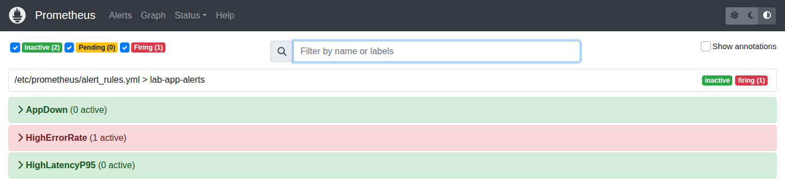
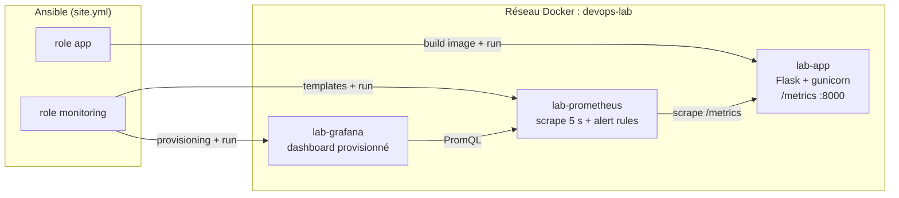

# DevOps Monitoring Lab — Docker · Ansible · Prometheus · Grafana

[](https://github.com/Marin-Weis/devops-monitoring-lab/actions/workflows/ci.yml)

Mini-lab d'**observabilité as code** : un service Python conteneurisé, déployé de façon **idempotente avec Ansible**, et supervisé par **Prometheus** (métriques + règles d'alerte) et **Grafana** (datasource et dashboard provisionnés automatiquement, sans aucune configuration manuelle dans l'interface).

Projet d'apprentissage personnel réalisé pour monter en compétences sur Ansible, Prometheus/Grafana et l'automatisation de déploiement (CI/CD).


*Dashboard Grafana pendant un test de charge avec 60 % d'erreurs forcées : l'alerte `HighErrorRate` est en `firing`.*



## Architecture



| Service | URL locale | Rôle |
|---|---|---|
| Application | http://localhost:8081 | Service Flask instrumenté (`/work`, `/health`, `/metrics`) |
| Prometheus | http://localhost:9090 | Collecte, stockage, règles d'alerte |
| Grafana | http://localhost:3000 | Dashboard (`admin` / `admin`, lab local uniquement) |

## Démarrage rapide

Prérequis : Docker, Python 3.10+, `make`.

```bash
make setup      # venv + Ansible + ansible-lint + collection community.docker
make deploy     # déploie toute la stack (relançable sans effet de bord)
make load       # 2 min de trafic à 10 req/s pour alimenter le dashboard
```

Ouvrir ensuite Grafana : le dashboard **« Lab DevOps — Vue d'ensemble de l'application »** est la page d'accueil.

### Déclencher l'alerte

```bash
make chaos      # force 60 % d'erreurs 5xx sur /work
make load       # génère du trafic
# → HighErrorRate passe pending puis firing après 30 s (http://localhost:9090/alerts)
make reset      # retour à 5 % d'erreurs
```

## Ce que fait chaque partie

### 1. Application (`app/`)
Service Flask qui expose des métriques de type **RED** (Rate, Errors, Duration) avec `prometheus_client` :

| Métrique | Type | Usage |
|---|---|---|
| `app_http_requests_total{method,endpoint,status}` | Counter | débit et taux d'erreurs |
| `app_http_request_duration_seconds{endpoint}` | Histogram | percentiles de latence (p50/p95/p99) |
| `app_http_requests_in_flight` | Gauge | requêtes en cours |
| `app_jobs_processed_total{result}` | Counter | métrique métier (succès/erreur) |

`POST /chaos/<taux>` (ex. `0.6`) modifie à chaud le taux d'erreurs simulées de `/work`, pour tester l'alerte. Image Docker : `python:3.12-slim`, utilisateur non-root, `HEALTHCHECK`, servie par gunicorn. 5 tests unitaires pytest.

### 2. Déploiement Ansible (`ansible/`)
- **Inventaire** `inventory/hosts.yml` : hôte local en connexion `local` (remplaçable par une VM en SSH).
- **Variables** `group_vars/all.yml` : ports, versions d'images, seuils d'alerte. Rien n'est codé en dur dans les rôles.
- **Rôle `app`** : build de l'image (`docker_image`), lancement du conteneur (`docker_container`), redémarrage par *handler* uniquement si l'image change.
- **Rôle `monitoring`** :
  - rend `prometheus.yml` et `alert_rules.yml` depuis des templates Jinja2 ;
  - **valide la config avec `promtool` avant de déployer** : une erreur de config fait échouer le playbook au lieu de casser Prometheus ;
  - provisionne la datasource et le dashboard Grafana (as code) ;
  - les *handlers* ne redémarrent Prometheus/Grafana que si un fichier de config change.
- **Idempotence vérifiée** : un second `make deploy` donne `changed=0`.
- **Playbook** `site.yml` : crée le réseau, applique les rôles, puis attend (`uri` + `retries`) que les trois services répondent.

### 3. Prometheus
- Scrape de l'application et de lui-même toutes les 5 s.
- 3 règles d'alerte (`alert_rules.yml.j2`), seuils pilotés par variables :

| Alerte | Condition | Sévérité |
|---|---|---|
| `AppDown` | `up == 0` pendant 30 s | critical |
| `HighErrorRate` | ratio de réponses 5xx > 10 % (fenêtre 1 min) | warning |
| `HighLatencyP95` | p95 > 0,5 s (`histogram_quantile`) | warning |

### 4. Grafana
Dashboard généré par `scripts/generate_dashboard.py` (le JSON est versionné) : débit, taux d'erreurs, latence p95, requêtes en cours, débit par code HTTP, percentiles de latence, jobs par résultat, disponibilité des cibles et tableau des alertes actives (`ALERTS`).

## CI (GitHub Actions)
À chaque push : tests pytest, `yamllint`, `ansible-lint`, vérification que le dashboard JSON est à jour, build de l'image Docker, et validation `promtool` de la configuration Prometheus rendue à partir des templates Ansible.

## Structure

```
.
├── app/                    # service Flask + Dockerfile + tests
├── ansible/
│   ├── site.yml            # playbook principal
│   ├── inventory/hosts.yml
│   ├── group_vars/all.yml  # variables (ports, versions, seuils)
│   └── roles/
│       ├── app/            # build + run du service
│       └── monitoring/     # Prometheus + Grafana (templates, dashboards, handlers)
├── scripts/
│   ├── generate_dashboard.py
│   └── loadgen.py          # générateur de trafic
├── .github/workflows/ci.yml
└── Makefile                # setup, deploy, load, chaos, reset, lint, test, destroy
```

## Pistes d'amélioration
- Ajouter **Alertmanager** (notifications e-mail/Slack) et un exporter système (`node_exporter`, cAdvisor).
- Cibler une VM distante en SSH et gérer les secrets avec `ansible-vault`.
- Convertir l'inventaire en inventaire dynamique et découper en rôles réutilisables (Ansible Galaxy).
- Tester les rôles avec Molecule.

## Nettoyage

```bash
make destroy    # supprime conteneurs, réseau, volumes et configs rendues
```

## Licence
MIT — projet pédagogique.
