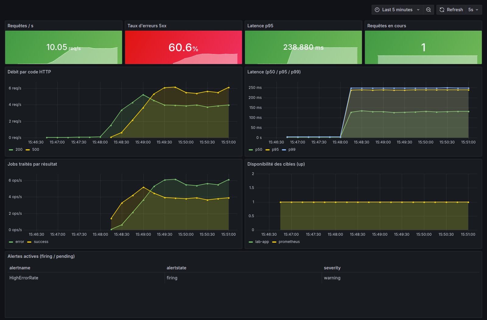
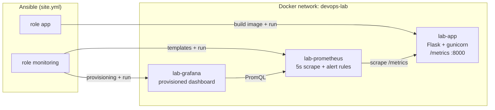

# DevOps Monitoring Lab — Docker · Ansible · Prometheus · Grafana

[](https://github.com/Marin-Weis/devops-monitoring-lab/actions/workflows/ci.yml)

Hands-on **observability as code** lab: a containerised Python service deployed **idempotently with Ansible**, and monitored by **Prometheus** (scraping + alert rules) and **Grafana** (datasource and dashboard provisioned automatically, with zero manual UI setup).

Personal self-training project built to get practical experience with Ansible automation, Prometheus alerting, Grafana provisioning as code, and CI/CD pipelines.



*Grafana dashboard during a load test with 60% forced HTTP 500 errors: the `HighErrorRate` alert is `firing`.*


## Architecture



| Service | Local URL | Role |
|---|---|---|
| Application | http://localhost:8081 | Instrumented Flask service (`/work`, `/health`, `/metrics`) |
| Prometheus | http://localhost:9090 | Metrics scraping, storage, and alert rule evaluation |
| Grafana | http://localhost:3000 | Pre-provisioned dashboard (`admin` / `admin`, local lab only) |

## Quick Start

Prerequisites: Docker, Python 3.10+, `make`.

```bash
make setup      # create venv + install Ansible, ansible-lint, community.docker
make deploy     # deploy the full stack (idempotent, safe to re-run)
make load       # generate 2 minutes of traffic (10 req/s) to populate graphs
```

Then open Grafana: **“DevOps Lab — Application Overview”** is set as the default home dashboard.

### Triggering an Alert

```bash
make chaos      # force 60% HTTP 500 errors on /work
make load       # generate traffic
# -> HighErrorRate moves from pending to firing after 30s (http://localhost:9090/alerts)
make reset      # restore error rate to 5%
```

## Components

### 1. Instrumented Application (`app/`)
A Flask service exposing **RED** metrics (Rate, Errors, Duration) using `prometheus_client`:

| Metric | Type | Purpose |
|---|---|---|
| `app_http_requests_total{method,endpoint,status}` | Counter | Request throughput and error ratio |
| `app_http_request_duration_seconds{endpoint}` | Histogram | Latency percentiles (p50 / p95 / p99) |
| `app_http_requests_in_flight` | Gauge | Concurrent requests currently being processed |
| `app_jobs_processed_total{result}` | Counter | Business counter (`success` / `error`) |

`POST /chaos/<rate>` (e.g. `0.6`) updates the simulated `/work` error rate at runtime to test alerting end to end. Docker image: `python:3.12-slim`, non-root user, `HEALTHCHECK`, served with gunicorn, covered by 5 pytest unit tests.

### 2. Idempotent Ansible Deployment (`ansible/`)
- **Inventory** (`inventory/hosts.yml`): single local host via `ansible_connection: local` (easily swapped for a remote VM over SSH).
- **Variables** (`group_vars/all.yml`): ports, image versions, scrape interval, and alert thresholds — nothing hardcoded inside roles.
- **Role `app`**: builds the image (`docker_image`), starts the container (`docker_container`), and restarts via a *handler* only when the image changes.
- **Role `monitoring`**:
  - renders `prometheus.yml` and `alert_rules.yml` from Jinja2 templates;
  - **validates configuration with `promtool` before deployment**: an invalid config fails the playbook instead of breaking Prometheus;
  - provisions the Prometheus datasource and Grafana dashboard as code;
  - *handlers* restart Prometheus/Grafana only when a configuration file changes.
- **Verified idempotency**: a second `make deploy` reports `changed=0`.
- **Playbook (`site.yml`)**: creates the Docker network, runs both roles, and waits (`uri` + `retries`) until all three services report healthy.

### 3. Prometheus
- Scrapes the application and itself every 5 seconds.
- 3 alert rules (`alert_rules.yml.j2`) driven by `group_vars`:

| Alert | Condition | Severity |
|---|---|---|
| `AppDown` | `up == 0` for 30s | critical |
| `HighErrorRate` | 5xx ratio > 10% (1m window) | warning |
| `HighLatencyP95` | p95 latency > 0.5s (`histogram_quantile`) | warning |

### 4. Grafana
Dashboard generated via `scripts/generate_dashboard.py` (with the resulting JSON version-controlled): throughput, 5xx error rate, p95 latency, in-flight requests, throughput by HTTP status, latency percentiles, jobs by result, target availability (`up`), and active alerts table (`ALERTS`).

## CI Pipeline (GitHub Actions)
Runs on every push and pull request:
- `pytest` unit tests
- `yamllint` + `ansible-lint` (`production` profile)
- Drift check ensuring the generated Grafana dashboard JSON is up to date
- Docker image build
- `promtool check config` on the Prometheus configuration rendered from Ansible templates

## Repository Layout

```
.
├── app/                    # Flask service + Dockerfile + unit tests
├── ansible/
│   ├── site.yml            # Main playbook
│   ├── inventory/hosts.yml
│   ├── group_vars/all.yml  # Ports, image versions, alert thresholds
│   └── roles/
│       ├── app/            # Build & run the Python service
│       └── monitoring/     # Prometheus + Grafana (templates, dashboards, handlers)
├── scripts/
│   ├── generate_dashboard.py
│   └── loadgen.py          # Traffic generator
├── .github/workflows/ci.yml
└── Makefile                # setup, deploy, load, chaos, reset, lint, test, destroy
```

## Possible Next Steps
- Add **Alertmanager** (email/Slack routing) and host/container exporters (`node_exporter`, cAdvisor).
- Target a remote VM over SSH and encrypt secrets with `ansible-vault`.
- Add role testing with Molecule.

## Cleanup

```bash
make destroy    # remove containers, Docker network, volumes, and rendered configs
```

## License
MIT
